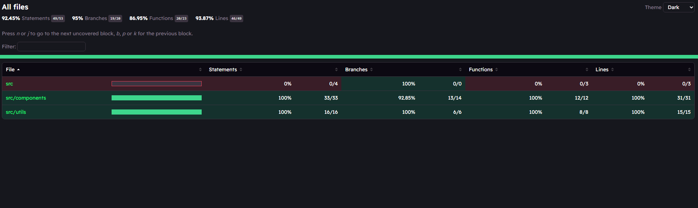

# Watford_react_testing Write-up

For the utility functions in 'cartUtils.ts', I wrote one 'describe' block per function and gave every test a name starting with "should". I focused on edge cases and boundary values, especially the discount cutoffs: I tested 49.99, 50, 99.99, and 100 to confirm the 0%, 5%, and 10% tiers switch at the right spots. I also tested an empty cart, a subtotal of zero, invalid quantities such as 0, negatives, decimals, and NaN, and rounding in 'formatCurrency' and 'calculateTotal'. For the 'ShoppingCart', I grouped tests by behavior (initial render, adding items, removing items, updating quantity, calculations, and clearing the cart) and used 'userEvent' with 'await' to simulate real typing and clicking. I wrote a small 'addItem' helper to keep the tests short, and I tested the invalid inputs the component should reject, such as an empty name, an empty price, a price of 0 or below, and a name made only of spaces. In total there are 49 passing tests.

The coverage report showed 92.45% statements, 95% branches, 86.95% functions, and 93.87% lines. The utility file achieved 100% on every count. The only uncovered code in the project was the starter 'App.tsx' file and one branch in the component, which was hard to reach through a number input. I learned how to read a coverage report and use it to see the sections of code my tests actually address. I also learned to use 'toBeCloseTo' for decimal math, since results like 0.1*3 are not exactly 0.3, and to 'await' every user interaction so the test doesn't check too early. Along the way I ran into a few mistakes: adding 'type' to imports for real functions like 'render' broke them, and the quantity input needed 'fireEvent' for one test because 'userEvent' could not cleanly enter a 0.

